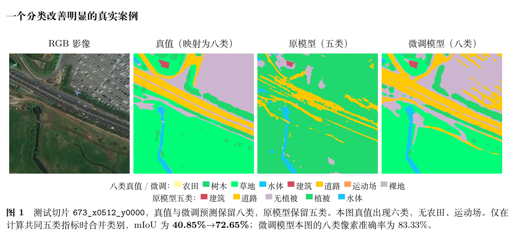

# ACPV-Net fine-tuning on IRSAMap: eight-class segmentation and vectorization

将 ACPV-Net 官方 Deventer-512 复现权重适配到 IRSAMap 八类地物任务，提供最终数据管线、分阶段微调、语义/矢量评估与推理程序。

**Classes:** farmland, tree, grass, water, building, road_area, sport, bareland.
**Dataset version:** `official-rvwsb-semantic-v3`. **Best checkpoint:** global step25000, selected on validation mIoU55.39%. The complete run finished31000 updates.

## Results

| IRSAMap test protocol | Original official weights | Fine-tuned |
|---|---:|---:|
| Native eight-class semantic mIoU | N/A | **65.94%** |
| Native eight-class macroF1 | N/A | **78.61%** |
| Native eight-class pixel accuracy | N/A | **81.64%** |
| Common five-class semantic mIoU |48.65%|**73.34%**|
| Eight-class polygon-rasterized mIoU, 200-step DDIM |N/A|**62.60%**|

Evaluated on all3648 test crops from912 official test images. Common-five evaluation merges tree/grass and excludes farmland/sport ground truth (93.47% pixel coverage); predictions of excluded classes on retained ground truth still count as errors. These project-specific metrics are not ACPV-Net/IRSAMap paper benchmark scores. Complete evidence and the concise TeX/PDF report are in [reports](reports/).



The displayed ground truth is the official label mapped to our eight training classes. This example contains six of those classes, with no farmland or sport. Its original-model panel uses a separate five-class legend.

## Quick start

```bash
git clone https://github.com/rykflashv17-cr/acpv-net-irsamap8.git
cd acpv-net-irsamap8
bash scripts/install.sh
source .venv/bin/activate
python program/download_artifacts.py model
python program/download_artifacts.py vae
CUDA_VISIBLE_DEVICES=0 python program/predict_irsamap8.py --image examples/rgb.png
```

Semantic masks and image-coordinate polygons are written to `outputs/irsamap8/inference/`. The default inference checkpoint contains model tensors and metadata only; a separate full checkpoint supports resuming training.

## Train / evaluate

```bash
python program/download_artifacts.py dataset-core
python program/download_artifacts.py dataset-latents
python program/download_artifacts.py official
python program/download_artifacts.py vae
CUDA_VISIBLE_DEVICES=0 python program/train_irsamap8.py --batch 8 --workers 8
CUDA_VISIBLE_DEVICES=0 python program/evaluate.py --split test
# Complete original-vs-finetuned common-five comparison after vector/full-mask export:
CUDA_VISIBLE_DEVICES=0 python program/compare_official_irsamap8.py
```

Resume from the validation-selected full checkpoint after downloading the same data and original initialization dependency:

```bash
python program/download_artifacts.py resume
CUDA_VISIBLE_DEVICES=0 python program/train_irsamap8.py --resume weights/training_checkpoint.pth --batch 8 --workers 8
```

Training:1000 head-only steps followed by30000 joint steps, AdamW, effective batch8, BF16, seed42. Learning rates: backbone3e-6, semantic3e-5, diffusion1e-5. VAE remains frozen. Train loss weights: mainCE1 + auxCE0.4 + noiseL1x10. Selection uses validation only. See [training config](configs/train.json), [data contract](docs/data.md), [environment](docs/environment.md), and [artifact manifest](manifests/artifacts.json).

## Downloads and provenance

- [Fine-tuned model and full training checkpoint](https://huggingface.co/Flash2718/acpv-net-irsamap8)
- [Prepared dataset](https://huggingface.co/datasets/Flash2718/irsamap-acpv8-v3): complete:47 verified archives covering all276006 source files, including152752 latent tensors.


The manifest pins model/dataset repository revisions and SHA256 values; the downloader verifies every artifact. Use your own Hugging Face authentication for private repositories.
`code/ACPV-Net` retains the upstream layout and our actual experiment modifications. `program/` contains project-specific entry points. The release removes machine-specific absolute paths and makes the final preprocessing pipeline independent of the old deleted data, without changing its geometry/semantic algorithms.

Upstream: [ACPV-Net](https://github.com/HeinzJiao/ACPV-Net), commit `cf28ca7adbabd653d39a7a3847eb160096fb200b`. Data: [IRSAMap](https://github.com/ucas-dlg/IRSAMap). [Attribution and license details](NOTICE.md). Code uses the retained CC BY-NC-SA4.0 upstream license; original checkpoint terms and dataset terms are recorded separately.
